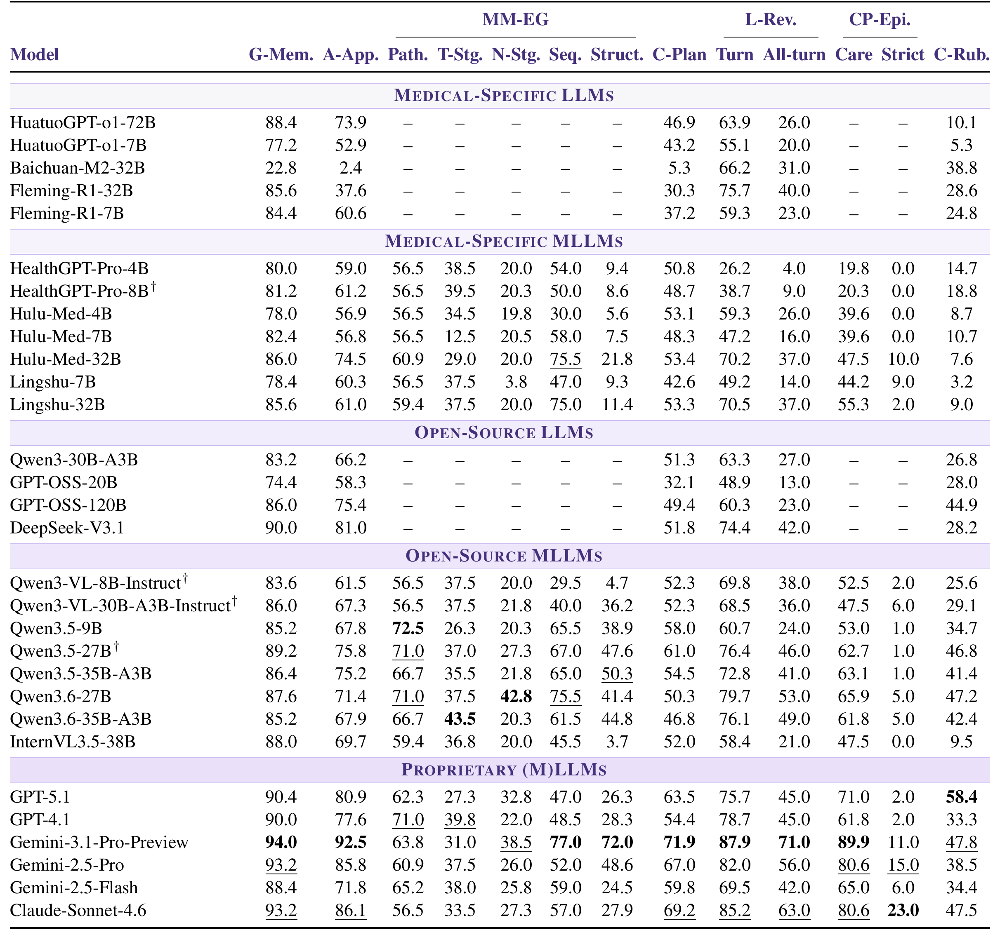
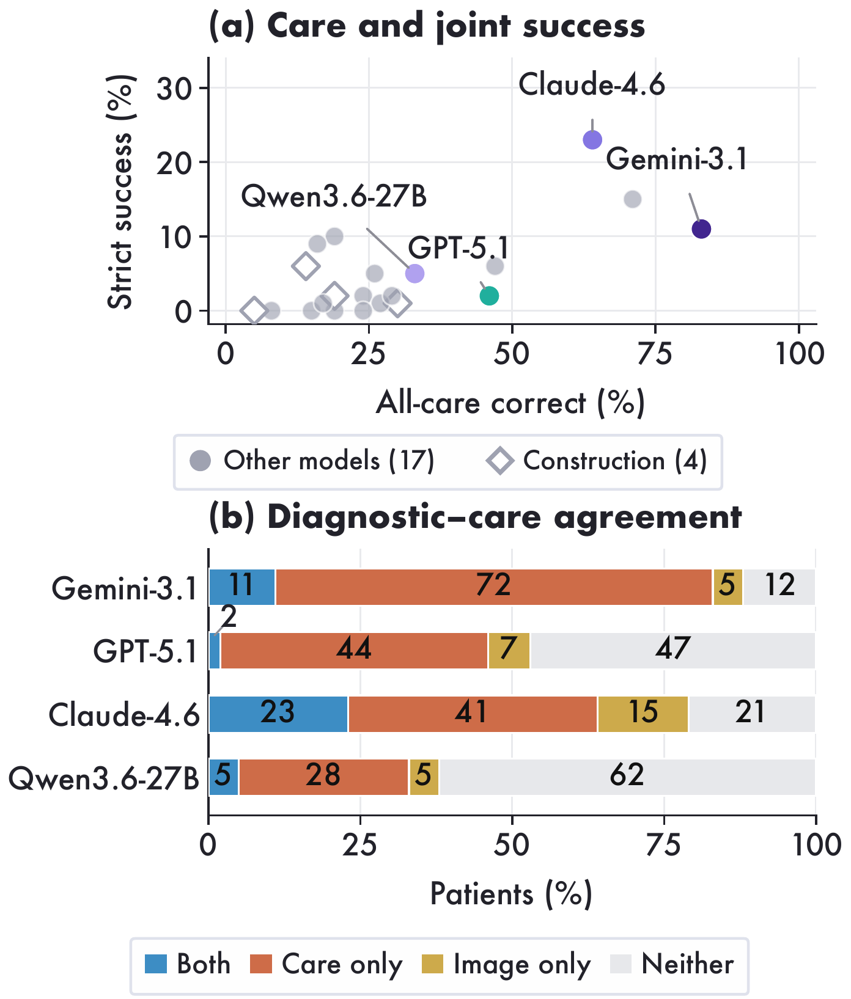
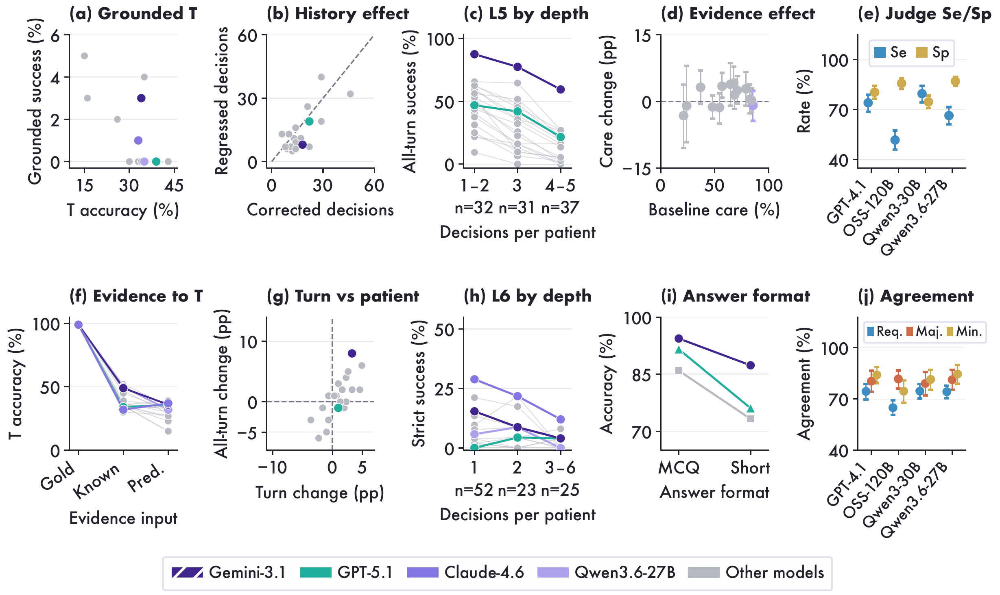

<h1 align="center">NPCBench</h1>

<p align="center">
  <strong>A Clinical Apprenticeship Benchmark for Multimodal Care-Pathway Reasoning in Nasopharyngeal Carcinoma</strong>
</p>

<p align="center">
  <a href="https://arxiv.org/abs/2611.08369"></a>
  <a href="https://huggingface.co/datasets/pengkaiScience/NPCBench"></a>
  <a href="https://neurips.cc/Conferences/2026/CallForEvaluationsDatasets"></a>
</p>

<p align="center">
  <a href="#news">News</a> · <a href="#benchmark">Benchmark</a> · <a href="#results">Results</a> · <a href="#quick-start">Quick start</a> · <a href="#evaluation">Evaluation</a> · <a href="#citation">Citation</a>
</p>

## News

- **NPCBench was accepted to the NeurIPS 2026 Evaluations & Datasets Track.** [Paper](https://arxiv.org/abs/2611.08369)

## Benchmark

NPCBench evaluates how models use clinical guidelines, pathology and MRI, and
patient history to make decisions in nasopharyngeal carcinoma care. Its six
levels progress from guideline recall to linked care episodes. The O1 task uses
case-specific rubrics to score open-ended consultations.

<p align="center">
  <a href="https://arxiv.org/html/2611.08369v1#S1.F1"></a>
</p>

| Level | What it evaluates | Size |
| :--- | :--- | :--- |
| L1 | Guideline recall | 250 questions |
| L2 | Guideline application | 185 questions |
| L3 | Pathology, MRI sequence and anatomy, and T/N staging | 69 pathology cases, 200 sequence questions, 2,700 structure cards, and 400 cases each for T and N staging |
| L4 | Case planning | 165 questions |
| L5 | Revising care as patient evidence changes | 305 decisions across 100 trajectories |
| L6 | Diagnostic and care decisions in linked CarePath episodes | 417 tasks across 100 patients |
| O1 | Open-ended specialist consultation | 103 consultations with 1,726 rubric criteria |

## Results

### Main benchmark table

Scores for **30 models** across L1–L6 and O1. Accuracy and success rates are percentages, and the consultation rubric score ranges from 0 to 100. [Table 1 and metric definitions](https://arxiv.org/html/2611.08369v1#S4.T1)

<p align="center">
  <a href="assets/results/main-results.png"></a>
</p>

### CarePath joint correctness

Gemini-3.1-Pro-Preview reached **89.9%** accuracy on individual care decisions and **11%** strict patient success. Claude-Sonnet-4.6 led strict success at **23%**. Strict success requires correct pathology, MRI T stage, and every scored care decision for the same patient. [Figure 6 and analysis](https://arxiv.org/html/2611.08369v1#S4.F6)

<p align="center">
  <a href="assets/results/carepath-joint-correctness.png"></a>
</p>

### Evidence, history, and judge checks

On 25 matched CarePath cases, reference diagnostic evidence changed patient-averaged care accuracy by **−3.2 to +4.1 percentage points** across 14 models. The panels also show where patient history changes decisions and where automated judges agree with physicians. [Figure 7 and analysis](https://arxiv.org/html/2611.08369v1#S4.F7)

<p align="center">
  <a href="assets/results/evaluation-controls.png"></a>
</p>

## Quick start

Install with Python 3.10 or later. This example downloads the L1 and O1 inputs.

```sh
git clone https://github.com/pidneuralode/NPCBench.git
cd NPCBench
python -m pip install . huggingface_hub
hf download pengkaiScience/NPCBench L1/questions.jsonl O1/questions.jsonl --repo-type dataset --local-dir data
```

For MRI and pathology inputs, see the
[L3 data guide](https://huggingface.co/datasets/pengkaiScience/NPCBench/blob/main/L3/README.md)
and the [CarePath data guide](https://huggingface.co/datasets/pengkaiScience/NPCBench/blob/main/L6/full100_inputs_scored217/README.md).

## Evaluation

### Choice and structured answers

Provide one JSONL record per question with its `id` and `response`, such as
`{"id":"question_id","response":"B"}`. Include all selected letters for
multiple-select questions and use `sample_id` for L6. For MRI tasks, follow the
answer format in the prompt.

```sh
npcbench choice --task L1 --predictions predictions.jsonl --output scores.json
```

Supported tasks are `L1`, `L2`, `L3-Path`, `L3-Seq`, `L3-Struct`, `T400`,
`N400`, `L4`, `L5`, and `L6`.

### O1 open answers

Provide one JSONL record per consultation with `item_id` and `response`.
Use `npcbench_eval.prompts.render_generation_messages` to format model inputs
as in the paper. Prepare the rubric prompts with:

```sh
npcbench open --responses responses.jsonl --output judge_requests.jsonl
```

Run these prompts with your judge and save each judgment with its `item_id`,
`rubric_id`, and Boolean `criteria_met`. Then score the judgments:

```sh
npcbench open --judgments judgments.jsonl --output scores.json
```

## Citation

```bibtex
@misc{wang2026npcbench,
  title = {NPCBench: A Clinical Apprenticeship Benchmark for Multimodal Care-Pathway Reasoning in Nasopharyngeal Carcinoma},
  author = {Wang, Pengkai and Zhang, Wei-Wei and Li, Yan and Tang, Min
            and Hou, Zhitian and Liu, Zeyu and Zhu, Guanghao and Wang, Yuanyi
            and Gu, Yanggan and Wang, Wenjun and Ni, Minheng and Xie, Congkai
            and Sang, Zhijie and Wu, Jianmin and Sun, Ying and Yang, Hongxia},
  year = {2026},
  eprint = {2611.08369},
  archivePrefix = {arXiv},
  primaryClass = {cs.AI},
  url = {https://arxiv.org/abs/2611.08369}
}
```

Code is licensed under [MIT](LICENSE). See the
[dataset license](https://huggingface.co/datasets/pengkaiScience/NPCBench/blob/main/LICENSE-DATA.md)
for data terms.
