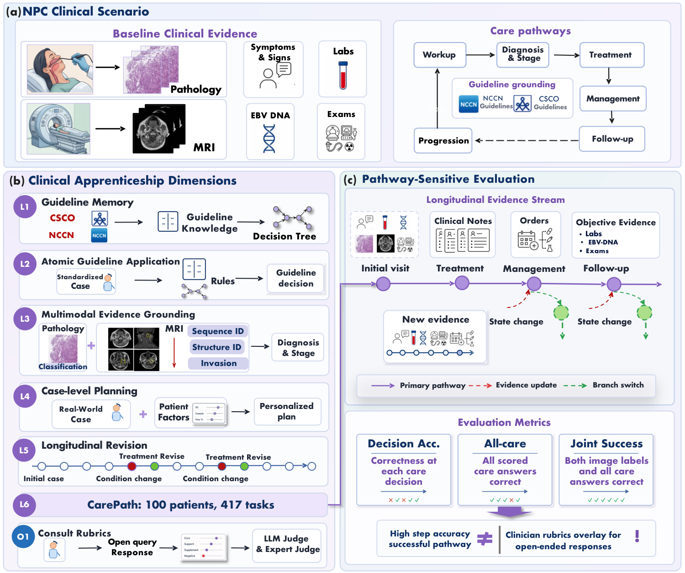

# NPCBench

NPCBench evaluates guideline knowledge, image interpretation, clinical decisions,
and specialist consultation in nasopharyngeal carcinoma.

[Paper](https://openreview.net/forum?id=AVTJEREEah) · [Dataset](https://huggingface.co/datasets/pengkaiScience/NPCBench) · [Results for 30 models](results/main_results.csv)



## Run the evaluation

Use Python 3.10 or later. This example downloads only the L2 questions.

```sh
git clone https://github.com/pidneuralode/NPCBench.git
cd NPCBench
python -m pip install . huggingface_hub
hf download pengkaiScience/NPCBench L2/questions.jsonl --repo-type dataset --local-dir data
npcbench-mcq-release --task L2 --parser final_answer_v1 \
  --dataset data/L2/questions.jsonl --predictions predictions.jsonl --output scores.json
```

Supply one row per question in `predictions.jsonl`, for example
`{"id":"question_id","response":"B"}`. Give the complete set of options for
multiple-select questions, such as `\boxed{C,D}`. The same scorer accepts `--task L1`
and `--task L4` with their respective question files.

Use `npcbench-l3`, `npcbench-l5`, `npcbench-l6`, and `npcbench-o1` for the other
tasks. Each command supports `--help`. The [MRI guide](docs/mri_extension.md)
covers archive extraction, T400/N400 scoring, and inference profiles. The data
card describes CarePath inputs and the consultation rubrics.

The [results directory](results/) includes staging, CarePath, external MRI,
and physician agreement. CarePath joint success requires correct pathology, MRI
T stage, and every scored care decision for a patient.

## License and citation

Code is [MIT](LICENSE). Original data and annotations are
[CC BY 4.0](LICENSE-DATA.md). Third-party materials retain their terms.
Please cite the paper using [CITATION.cff](CITATION.cff).
