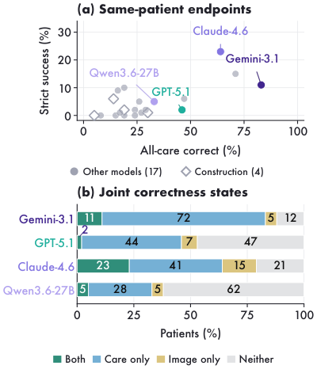

# NPCBench

**A Clinical Apprenticeship Benchmark for Multimodal Care-Pathway Reasoning in Nasopharyngeal Carcinoma**

[Paper](https://openreview.net/forum?id=AVTJEREEah) · [Data](https://huggingface.co/datasets/pengkaiScience/NPCBench)

NPCBench asks whether models can connect guideline knowledge, image evidence and
clinical decisions across a patient's care. It includes six task levels and an
open-ended consultation task, evaluated across 30 models.


## Benchmark

| Task | Evaluation set |
|---|---|
| L1 · Guideline memory | 250 questions |
| L2 · Rule application | 185 questions |
| L3 · Multimodal grounding | 69 pathology cases; 200 sequence questions; 2,700 structure cards; 400 T-stage and 400 N-stage cases |
| L4 · Case planning | 165 questions from 84 patients |
| L5 · Longitudinal revision | 305 decisions from 100 patients |
| L6 · CarePath | 100 patients, 217 scored care decisions |
| O1 · Consultation | 103 questions from 42 cases, 1,726 criteria |

T and N cohorts are disjoint. The 100-patient anatomical panel is part of T400.
Task cohorts overlap elsewhere, so these counts are not additive patient totals.
Six L6 treatment questions are unscored pending clinical review.
An independent T-stage panel contains 53 patients from Nanfang Hospital.

## Results

Scores are percentages; higher is better. Full100 joint success requires correct
pathology and MRI T labels and every scored care decision for a patient.
The [complete results](results/main_results.csv) cover all 30 models.
[External-centre results](results/external_mri.csv) report the separate MRI panel.

| Model | L2 | T400 | N400 | L5 turn | Full100 joint | O1 |
|---|---:|---:|---:|---:|---:|---:|
| GPT-5.1 | 80.9 | 27.2 | 32.8 | 75.7 | 2.0 | 58.4 |
| GPT-4.1 | 77.6 | 39.8 | 22.0 | 78.7 | 2.0 | 33.3 |
| Gemini-3.1-Pro-Preview | 92.5 | 31.0 | 38.5 | 87.9 | 11.0 | 47.8 |
| Claude-Sonnet-4.6 | 86.1 | 33.5 | 27.3 | 85.2 | 23.0 | 47.5 |
| Qwen3.6-35B-A3B | 67.9 | 43.5 | 20.2 | 76.1 | 5.0 | 42.4 |
| Qwen3.6-27B | 71.4 | 37.5 | 42.8 | 79.7 | 5.0 | 47.2 |
| Hulu-Med-32B | 74.5 | 29.0 | 20.0 | 70.2 | 10.0 | 7.6 |
| GPT-OSS-120B | 75.4 | — | — | 60.3 | — | 44.9 |



## Install and download

```sh
git clone https://github.com/pidneuralode/NPCBench.git
cd NPCBench
pip install .
pip install huggingface_hub
hf download pengkaiScience/NPCBench --repo-type dataset --local-dir data
tar -xzf data/L3/images_and_inputs.tar.gz -C data/L3
tar -xzf data/L6/carepath.tar.gz -C data/L6
for shard in data/L3/extensions/images-*.tar; do
  tar -xf "$shard" -C data/L3/extensions
done
```

Python 3.10 or later is required. Install model-specific inference dependencies
in the environment used for that model.

## Score predictions

Save one JSONL row per question: `{"id":"question_id","response":"B"}`.
L6 uses `sample_id` instead of `id`.

```sh
npcbench-mcq-release --task L2 --parser final_answer_v1 \
  --dataset data/L2/questions.jsonl --predictions outputs/l2.jsonl \
  --output outputs/l2_scores.json
npcbench-mri-extension score --stage T --labels data/L3/T400.jsonl \
  --predictions outputs/t400.jsonl --output outputs/t400_scores.json
npcbench-mri-extension score --stage N --labels data/L3/N400.jsonl \
  --predictions outputs/n400.jsonl --output outputs/n400_scores.json
npcbench-l5 --dataset data/L5/questions.jsonl \
  --predictions outputs/l5.jsonl --output outputs/l5_scores.json
npcbench-l6 --dataset-root data/L6/full100_inputs_scored217 \
  --predictions outputs/l6.jsonl --output outputs/l6_scores.json
```

Use `--task L1` or `--task L4` for the other choice tasks. L2 averages four
capability groups; L4 averages patient scores. Multiple-choice questions require
the complete unordered option set, such as `\boxed{C,D}`. L5 reports both turn
accuracy and all-turn patient success. MRI scoring includes class recall,
balanced accuracy and T-stage results by input format.

`npcbench-l3 --help` covers pathology, sequence recognition and structure cards.
`npcbench-o1 --help` covers consultation generation, criterion judging and score
aggregation. The paper uses GPT-OSS-120B as the O1 judge.

## Generate responses

See [MRI inference](docs/mri_extension.md) for image layouts, model-specific
contexts, local configurations and API commands. The data include prompts and
ordered image paths. Use the corresponding task prompt and model profile.

```sh
CUDA_VISIBLE_DEVICES=0,1 npcbench-infer \
  --config configs/mri_extension/tn/qwen3_vl_8b_instruct.json \
  --model-path /path/to/Qwen3-VL-8B-Instruct \
  --requests data/L3/extensions/requests.jsonl \
  --asset-root data/L3/extensions --output-dir outputs/qwen3vl
```

## License and citation

Code: [MIT](LICENSE). Original data and annotations: [CC BY 4.0](LICENSE-DATA.md).
Third-party materials retain their terms. Citation details are in [CITATION.cff](CITATION.cff).
